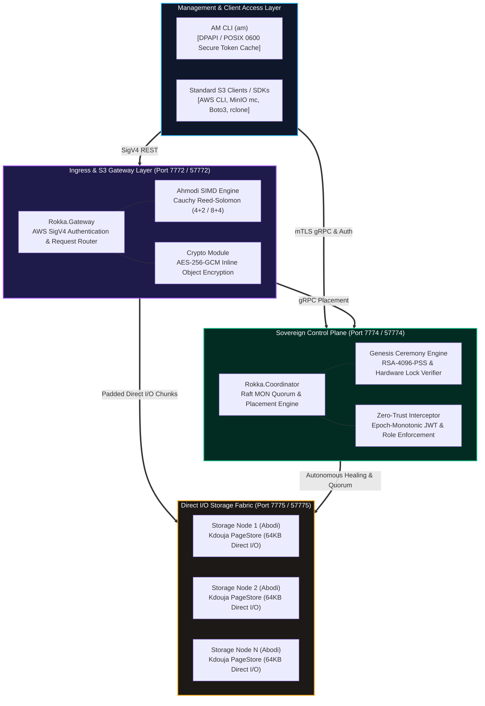
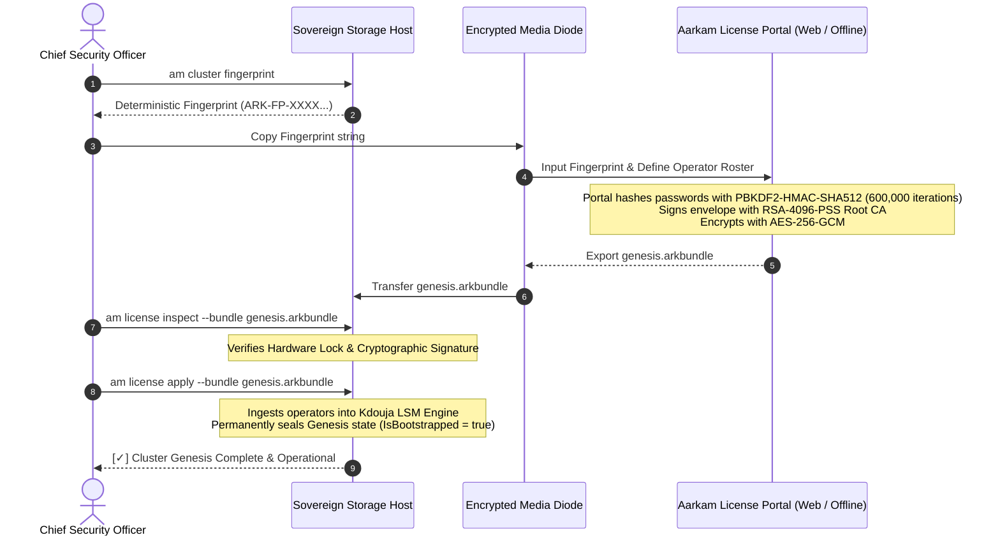

# Aarkam Sovereign Enterprise Cloud & Storage Substrate
# Production Air-Gapped Installation & Deployment Guide

| Specification | Details |
| :--- | :--- |
| **Document Identifier** | `ARK-DOC-INSTALL-V1.0.0` |
| **Release Version** | `V-1.0.0-GA (Production)` |
| **Target Audience** | Sovereign Cloud Engineers, System Administrators, Defense Datacenter Operators, CISOs |
| **Classification** | Enterprise Operations Standard |
| **Cybersecurity Standards** | Saudi NCA ECC-2:2024, NCA CSCC-1:2023, FIPS 140-3 Zero-Trust Architecture |
| **Target Environments** | 100% Air-Gapped, Zero-Egress Datacenters (Bare-Metal & Private Cloud) |

---

## 1. System Overview & Architecture

The **Aarkam Tier 1 Sovereign Storage Substrate** provides an autonomous, enterprise-grade, high-performance object and key-value storage fabric designed specifically for air-gapped sovereign environments where external internet connectivity is strictly prohibited (zero telemetry, zero cloud callbacks).



### Core Subsystems:
1. **`am` (Unified AM CLI)**:
   - Sovereign administration tool. Interacts with the Coordinator and Gateway.
   - Built-in cluster hardware profiling, genesis activation, operator authentication, and native S3 client commands.
   - Credentials protected via Windows DPAPI (`%LOCALAPPDATA%\Aarkam\am_auth.dat`) or POSIX 0600 on Linux (`~/.aarkam/am_auth.dat`).
2. **`rokka-coordinator`**:
   - Master orchestrator and consensus authority (Raft MON quorum).
   - Manages node membership, dynamic Cauchy stripe placement, and operator identity metadata stored inside Kdouja LSM tables.
   - Enforces cluster-wide RBAC via gRPC interceptors.
3. **`rokka-gateway`**:
   - High-throughput S3 API endpoint compliant with AWS SigV4.
   - Houses the Ahmodi Cauchy Reed-Solomon (4+2, 8+4) SIMD erasure coding engine and AES-256-GCM cipher pipeline.
   - Handles streaming hedged reads with automatic node cycling and failover.
4. **`abodi`**:
   - High-speed block and chunk storage daemon.
   - Interfaces directly with physical drives via Kdouja Direct I/O `PageStore`, enforcing exact 66,048-byte physical sector alignment (512-byte header + 64KB payload).
   - Monitors SMART drive health telemetry and executes autonomous, non-disruptive proactive healing.

---

## 2. Hardware & Operating System Requirements

### Supported Operating Systems
- **Linux (x86_64)**:
  - Red Hat Enterprise Linux (RHEL) 8.8+ / 9.2+
  - Rocky Linux 9.x / AlmaLinux 9.x
  - Ubuntu Server 22.04 LTS / 24.04 LTS
- **Windows (x64)**:
  - Windows Server 2022 / Windows Server 2025
  - Windows 11 Enterprise (for developer/workstation edge deployments)

### Minimum Hardware Specifications

| Profile | CPU Architecture | RAM | Primary Storage (OS / Logs) | Data Storage (PageStore) | Network Fabric |
| :--- | :--- | :--- | :--- | :--- | :--- |
| **Edge / Single-Node Dev** | 4 Cores (AVX2 supported) | 8 GB | 64 GB SSD | 250 GB NVMe / SSD | 1 GbE |
| **Production Standard** | 16 Cores (AVX-512 / AVX2) | 64 GB | 256 GB NVMe | 4 TB+ NVMe / SAS SSD | 10 GbE / 25 GbE |
| **Defense / Enterprise Scale** | 32+ Cores per Node | 128 GB+ ECC | 512 GB RAID-1 NVMe | Dedicated NVMe-oF / Direct SAS | 100 GbE RoCE / IB |

> [!IMPORTANT]
> The Cauchy erasure coding math engine utilizes AVX2 and AVX-512 SIMD vector instructions. Verify AVX support using `lscpu | grep avx` on Linux or `Get-CimInstance Win32_Processor` on Windows.

---

## 3. Network Architecture & Port Map

In strict compliance with Saudi NCA ECC-2:2024, the storage cluster requires **zero internet access**. All traffic is contained within the local datacenter storage network.

| Port | Protocol | Encryption | Direction | Description |
| :---: | :---: | :---: | :---: | :--- |
| **`7772`** | HTTP / HTTPS | TLS 1.3 / SigV4 | Ingress | **S3 API Gateway & Kdouja REST KV API** (Standard Data Plane) |
| **`7774`** | gRPC | Mutual TLS (mTLS) | Internal / Ingress | **Coordinator Control Plane** (Consensus, RBAC, Metadata) |
| **`7775`** | gRPC | Mutual TLS (mTLS) | Internal | **Abodi Storage Daemon** (Direct I/O Chunk Read/Write/Release) |
| **`7776`** | gRPC | Mutual TLS (mTLS) | Internal | **Abodi SMART Telemetry & Autonomous Healing Engine** |
| **`57772`** | HTTP / HTTPS | TLS 1.3 | Optional | Secondary / Legacy S3 Gateway port |
| **`57774`** | gRPC | mTLS | Optional | Secondary / Legacy Coordinator port |
| **`57775`** | gRPC | mTLS | Optional | Secondary / Legacy Abodi port |
| **`57776`** | gRPC | mTLS | Optional | Secondary / Legacy Telemetry port |

---

## 4. Package Manifest & Extraction

The distribution bundles are available in `dist/bundles/`:

```
dist/bundles/
├── am-v1.0.0-linux-x64.zip                 # Standalone Linux AM CLI (~35 MB)
└── am-v1.0.0-win-x64.zip                   # Standalone Windows AM CLI (~32 MB)
```

### 4.1 Linux Installation
Extract the substrate package to `/opt/aarkam`:
```bash
sudo mkdir -p /opt/aarkam /etc/aarkam /var/lib/aarkam/{coordinator,storage,gateway} /var/log/aarkam
sudo unzip rokka-substrate-v2.5.0-linux-x64.zip -d /opt/aarkam/
sudo chmod +x /opt/aarkam/bin/*
sudo ln -sf /opt/aarkam/bin/am /usr/local/bin/am
```

Directory layout:
```
/opt/aarkam/
├── bin/
│   ├── am                      # Unified Sovereign Management CLI
│   ├── rokka-coordinator       # Raft MON & Placement Daemon
│   ├── rokka-gateway           # AWS SigV4 S3 & KV Gateway
│   └── abodi                   # Direct I/O Chunk Storage Daemon
├── config/
│   ├── gateway.settings.json   # S3 Gateway Configuration
│   └── abodi.settings.json     # Storage & Drive Geometry Configuration
└── certs/                      # Internal Cluster mTLS Certificates
```

### 4.2 Windows Installation
Extract the substrate package to `C:\Aarkam`:
```powershell
New-Item -ItemType Directory -Path "C:\Aarkam", "C:\Aarkam\data\coordinator", "C:\Aarkam\data\storage" -Force
Expand-Archive -Path ".\dist\bundles\rokka-substrate-v2.5.0-win-x64.zip" -DestinationPath "C:\Aarkam" -Force

# Add AM CLI to System PATH
[Environment]::SetEnvironmentVariable("Path", $env:Path + ";C:\Aarkam\bin", [EnvironmentVariableTarget]::Machine)
```

---

## 5. The Sovereign Cluster Genesis Ceremony (One-Time Activation)

In sovereign zero-trust architecture, **no default admin account exists in code, configuration, or database migrations**. The cluster begins in an uninitialized Genesis state (`IsBootstrapped = false`).



### Step 5.1: Extract Hardware Fingerprint
Run the native profiler command on the primary cluster node:
```bash
# Linux
am cluster fingerprint

# Windows
am.exe cluster fingerprint
```

**Example Terminal Output:**
```text
╔══════════════════════════════════════════════════════════════════════════════╗
║            AARKAM ROKKA CLUSTER HARDWARE FINGERPRINT (SOVEREIGN)             ║
╠══════════════════════════════════════════════════════════════════════════════╣
║ Cluster Fingerprint :  ARK-FP-AD8FF9EE-77AEB122-F222165B                    ║
╠══════════════════════════════════════════════════════════════════════════════╣
║ Host Machine        :  SOV-STORAGE-01                                       ║
║ Architecture        :  X64                                                  ║
║ CPU Cores           :  32                                                   ║
║ System Machine GUID :  3a84f901-b21a-4c28-98e3-a09918231902                 ║
║ Primary MAC         :  1CBFC0369059                                         ║
╚══════════════════════════════════════════════════════════════════════════════╝
```

### Step 5.2: Generate Sealed Genesis Bundle
1. Log in to the [Aarkam Enterprise Portal](https://aarkam.io/Administration/CurrentSubscription) on an external or bastion terminal.
2. Bind the **Cluster Fingerprint** (`ARK-FP-AD8FF9EE-77AEB122-F222165B`).
3. Add Sovereign Operators with granular roles:
   - `secadmin` (Roles: `ClusterAdmin`, `SecurityOfficer`)
   - `storageop` (Roles: `StorageOperator`)
   - `auditor` (Roles: `Auditor`)
4. Download the generated `.arkbundle` file (`genesis.arkbundle`) to secure media.

### Step 5.3: Offline Pre-Flight Inspection
Verify the bundle integrity on the air-gapped machine before activation:
```bash
am license inspect --bundle ./genesis.arkbundle
```
Confirm that:
- `Signature Status` is `[VALID] RSA-PSS-SHA512 Verified`.
- `Hardware Lock` indicates `MATCH (Bound to this host)`.
- The operator roster matches your designated security officers.

### Step 5.4: Ingest and Seal Genesis Bundle
Apply the genesis bundle to activate the cluster:
```bash
am license apply --bundle ./genesis.arkbundle
```
**Outcome**:
- The Coordinator validates the RSA-4096-PSS digital signature.
- Verifies physical hardware lock equality.
- Stores operator credentials (PBKDF2 hashes) into Kdouja LSM table `0x10`.
- Irreversibly seals the genesis transition (`IsBootstrapped = true`).

---

## 6. Service Configuration & Daemon Startup

### 6.1 Linux systemd Units

Create the systemd service definitions in `/etc/systemd/system/`:

#### `rokka-coordinator.service`
```ini
[Unit]
Description=Aarkam Rokka Sovereign Coordinator & Consensus Daemon
After=network.target
Wants=network.target

[Service]
Type=simple
User=root
WorkingDirectory=/opt/aarkam
ExecStart=/opt/aarkam/bin/rokka-coordinator --urls "http://0.0.0.0:7774"
Restart=always
RestartSec=3s
LimitNOFILE=1048576
LimitMEMLOCK=infinity
Environment="ASPNETCORE_ENVIRONMENT=Production"
Environment="AARKAM_STORAGE_PATH=/var/lib/aarkam/coordinator"

[Install]
WantedBy=multi-user.target
```

#### `abodi-node.service`
```ini
[Unit]
Description=Aarkam Abodi Physical Storage Daemon (Direct I/O Kdouja Engine)
After=network.target rokka-coordinator.service
Wants=rokka-coordinator.service

[Service]
Type=simple
User=root
WorkingDirectory=/opt/aarkam
ExecStart=/opt/aarkam/bin/abodi --urls "http://0.0.0.0:7775"
Restart=always
RestartSec=3s
LimitNOFILE=1048576
Environment="ASPNETCORE_ENVIRONMENT=Production"
Environment="Abodi__CoordinatorEndpoint=http://127.0.0.1:7774"
Environment="Abodi__StorageBasePath=/var/lib/aarkam/storage"

[Install]
WantedBy=multi-user.target
```

#### `rokka-gateway.service`
```ini
[Unit]
Description=Aarkam Rokka Sovereign S3 & Kdouja REST Gateway
After=network.target rokka-coordinator.service abodi-node.service
Wants=rokka-coordinator.service abodi-node.service

[Service]
Type=simple
User=root
WorkingDirectory=/opt/aarkam
ExecStart=/opt/aarkam/bin/rokka-gateway --urls "http://0.0.0.0:7772"
Restart=always
RestartSec=3s
LimitNOFILE=1048576
Environment="ASPNETCORE_ENVIRONMENT=Production"
Environment="Rokka__CoordinatorEndpoint=http://127.0.0.1:7774"

[Install]
WantedBy=multi-user.target
```

#### Enable & Start Daemons:
```bash
sudo systemctl daemon-reload
sudo systemctl enable --now rokka-coordinator abodi-node rokka-gateway
sudo systemctl status rokka-coordinator abodi-node rokka-gateway --no-pager
```

### 6.2 Windows Startup (PowerShell)

For Windows Server deployments, start the services in background jobs or register them with NSSM / Windows Service Controller:
```powershell
# Start Coordinator Daemon
Start-Process -FilePath "C:\Aarkam\bin\rokka-coordinator.exe" -ArgumentList '--urls "http://0.0.0.0:7774"' -WorkingDirectory "C:\Aarkam" -WindowStyle Hidden

# Start Abodi Storage Daemon
Start-Process -FilePath "C:\Aarkam\bin\abodi.exe" -ArgumentList '--urls "http://0.0.0.0:7775"' -WorkingDirectory "C:\Aarkam" -WindowStyle Hidden

# Start S3 Gateway Daemon
Start-Process -FilePath "C:\Aarkam\bin\rokka-gateway.exe" -ArgumentList '--urls "http://0.0.0.0:7772"' -WorkingDirectory "C:\Aarkam" -WindowStyle Hidden
```

---

## 7. Zero-Trust Operator Authentication & RBAC

All administrative invocations are cryptographically validated by the cluster interceptor.

### 7.1 Operator Login
Authenticate using your provisioned sovereign credentials:
```bash
am auth login --username secadmin --password "YourMasterPassword123!"
```
**Output:**
```text
[✓] Successfully authenticated as 'secadmin'.
    Tenant:        system
    Roles:         ClusterAdmin, SecurityOfficer
    Session Token: eyJhbGciOiJIUzI1NiIsInR5cCI6IkpXVCJ9...
    Expires UTC:   2026-10-24 21:00:00Z
```

### 7.2 Session Inspection
Verify active session claims and roles:
```bash
am auth whoami
```
```text
secadmin (tenant: system, roles: [ClusterAdmin, SecurityOfficer])
```

### 7.3 Cluster Health Doctor
Run full pre-flight and diagnostics:
```bash
am doctor --coordinator http://localhost:7774
```

---

## 8. S3 Storage Operations & Verification

### 8.1 S3 Bucket Management
```bash
# Create sovereign bucket
am s3 mb s3://sovereign-vault

# List all buckets
am s3 ls
```

### 8.2 Cauchy (4+2) Erasure-Coded Object Upload
Upload data directly through the S3 Gateway:
```bash
# Upload file with AES-256-GCM encryption & Cauchy 4+2 EC
am s3 cp ./telemetry.bin s3://sovereign-vault/telemetry.bin
```

### 8.3 Verify Object Metadata
```bash
am s3 stat s3://sovereign-vault/telemetry.bin
```
**Example Response:**
```text
Object: s3://sovereign-vault/telemetry.bin
Size:   1048576 bytes
ETag:   "b4c3e8092a187d90f234c90ab21e8432"
Stripe: Cauchy 4+2 (64KB Chunks, AES-256-GCM)
Status: Healthy (6/6 Chunks Replicated)
```

### 8.4 Streaming Download with On-the-Fly Reconstruction
```bash
am s3 cp s3://sovereign-vault/telemetry.bin ./downloaded_telemetry.bin
```

### 8.5 Bit-for-Bit Parity Verification
```bash
# Linux
sha256sum ./telemetry.bin ./downloaded_telemetry.bin

# Windows PowerShell
Get-FileHash ./telemetry.bin, ./downloaded_telemetry.bin -Algorithm SHA256
```
Confirm that both SHA-256 digests are **100% identical**.

---

## 9. Direct LSM Key-Value Operations

The storage fabric includes a high-speed direct LSM Key-Value interface:

```bash
# Insert Record
am kv put config/net_topology '{"nodes": 4, "mtu": 9000}' --tenant sovereign

# Fast Point Lookup (< 4 μs)
am kv get config/net_topology --tenant sovereign

# Range Scan by Prefix
am kv scan --prefix config/ --tenant sovereign

# Delete Record (Triggers Page Deallocation)
am kv del config/net_topology --tenant sovereign

# Trigger LSM Level Compaction
am kv compact
```

---

## 10. Operational Troubleshooting Matrix

| Diagnostic Symptom | Probable Root Cause | Resolution Steps |
| :--- | :--- | :--- |
| `Hardware Lock: MISMATCH` | Target node MAC address, CPU, or motherboard GUID differs from license envelope. | Re-run `am cluster fingerprint` on the active node, update the subscription in the Portal, download a newly sealed `.arkbundle`, and re-apply. |
| `Cryptographic signature verification failed` | Bundle payload corrupted or modified in transit. | Verify media integrity. Do not edit `.arkbundle` manually; re-export from Portal. |
| `[✗] Authentication Required` | Operator session expired, revoked, or not initiated. | Execute `am auth login --username <operator>` to generate a new DPAPI-cached session token. |
| `ArgumentOutOfRangeException (Stripe nodes)` | Cluster running with fewer nodes than Cauchy stripe width ($N < K+M$). | Automatic dynamic node cycling is enabled in v2.5.0. Ensure binaries are running v2.5.0 or later. |
| `PageStore Write Error: PhysicalPageSizeBytes mismatch` | Direct I/O payload was not padded to 66,048 bytes. | Verify `abodi` is updated to v2.5.0 (`PhysicalPageSizeBytes` padding invariant). |
| `Connection refused: Port 7772` | `rokka-gateway` is down or port is blocked by host firewall. | Check `systemctl status rokka-gateway`. Verify local firewall: `sudo ufw allow 7772/tcp` or `New-NetFirewallRule -Port 7772`. |

---
**Certified by Aarkam Sovereign Systems Group**  
*Compliant with Saudi National Cybersecurity Authority (NCA) ECC-2:2024*
