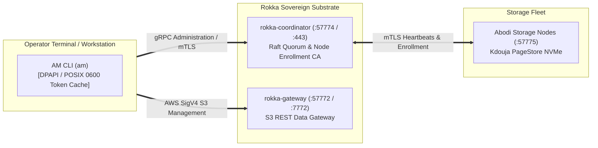

# Aarkam AM CLI — Sovereign Fabric Management CLI
# Official Production Air-Gapped Installation Guide (Version 1.0.2-GA)

| Specification | Details |
| :--- | :--- |
| **Document Identifier** | `ARK-AM-INSTALL-V1.0.2` |
| **Product** | Aarkam Control Plane Management CLI (`am`) |
| **Release Version** | `V-1.0.2-GA (Production Stable)` |
| **Architectural Scope** | Unified Administrative Control Plane CLI for Rokka & Abodi |
| **Target Audience** | Enterprise Storage Administrators, Infrastructure Operators, Defense Datacenter Engineers |
| **Compliance Level** | Saudi NCA ECC-2:2024, NCA CSCC-1:2023, FIPS 140-3 Zero-Trust Architecture |
| **Target Distribution** | Zero-Egress Air-Gapped Datacenters (Linux x64, Windows Server x64, OCI Container) |

---

## 1. Overview & Architecture

The **Aarkam AM CLI** (`am`) is the unified command-line control tool for managing the entire Aarkam sovereign storage ecosystem. It communicates with the **Rokka Coordinator** via secure gRPC / mTLS and provides full administrative lifecycle management:
- Operator Authentication & Zero-Trust RBAC.
- Cluster Topology, Health, and Consensus Quorum Monitoring.
- Node Enrollment Token Issuance for **Abodi** physical storage nodes.
- High-Throughput S3 REST Bucket & Key Lifecycle Management.



---

## 2. Standardized Endpoint Matrix

| Target Subsystem | Port | Protocol | Default Sovereign DNS URL | Description |
| :--- | :--- | :--- | :--- | :--- |
| **Rokka Coordinator** | `57774` (or `443`) | HTTPS / mTLS | `https://rokka-coordinator.aarkam:57774`<br/>`https://rokka-coordinator.aarkam` | Sovereign Control Plane, Raft Quorum & Token Issuance |
| **Rokka Coordinator Probe** | `7774` | HTTP Cleartext | `http://rokka-coordinator.aarkam:7774` | Internal gRPC & Health Probe (`/health`) |
| **Rokka S3 Gateway** | `57772` (or `443`) | HTTPS REST | `https://rokka-gateway.aarkam:57772`<br/>`https://rokka-gateway.aarkam` | Secure SigV4 S3 REST API |
| **Rokka S3 Gateway (Cleartext)** | `7772` | HTTP REST | `http://rokka-gateway.aarkam:7772` | High-Throughput S3 REST API (Local/VPC Ingestion) |
| **Abodi Storage Node** | `57775` | gRPC (mTLS) | `https://<node-ip>:57775` | Kdouja Direct I/O Chunk Storage Interface |
| **Abodi Telemetry Probe** | `7776` | HTTP Cleartext | `http://<node-ip>:7776` | Local Diagnostic Health Probe (`/health`) |

---

## 3. Binary Package Download (GitHub Releases)

Official standalone binaries and air-gapped installation bundles are distributed via [GitHub Releases (v1.0.2)](https://github.com/aarkamio/Aarkam/releases/tag/v1.0.2).

| Platform | Package Asset | Download Link |
| :--- | :--- | :--- |
| **Linux (x64)** | `am-v1.0.2-linux-x64.zip` | [Download from GitHub](https://github.com/aarkamio/Aarkam/releases/download/v1.0.2/am-v1.0.2-linux-x64.zip) |
| **Windows (x64)** | `am-v1.0.2-win-x64.zip` | [Download from GitHub](https://github.com/aarkamio/Aarkam/releases/download/v1.0.2/am-v1.0.2-win-x64.zip) |

---

## 4. Windows Installation (`C:\Program Files\Aarkam\AM`)

Under Microsoft Windows Enterprise & Saudi NCA security compliance:
- Binaries are deployed strictly to **`C:\Program Files\Aarkam\AM\`** (protected by Windows Administrator UAC).
- Operator tokens are cached in **`%LOCALAPPDATA%\Aarkam\`** (encrypted via Windows DPAPI / CNG).

### Option A: Automated Installation (Recommended)
1. Download and extract `am-v1.0.2-win-x64.zip`:
   ```powershell
   Invoke-WebRequest -Uri "https://github.com/aarkamio/Aarkam/releases/download/v1.0.2/am-v1.0.2-win-x64.zip" -OutFile "am-v1.0.2-win-x64.zip"
   Expand-Archive -Path "am-v1.0.2-win-x64.zip" -DestinationPath ".\am-v1.0.2-win-x64" -Force
   cd ".\am-v1.0.2-win-x64"
   ```
2. Open PowerShell as **Administrator** and execute the installer:
   ```powershell
   .\install-am.ps1
   ```
3. The script:
   - Deploys `am.exe` to `C:\Program Files\Aarkam\AM\am.exe`.
   - Adds `C:\Program Files\Aarkam\AM` to the Machine `PATH` environment variable safely.
   - Broadcasts `WM_SETTINGCHANGE` so all terminals recognize `am` immediately without rebooting.
4. Verify in a new PowerShell window:
   ```powershell
   am --version
   ```

### Option B: Manual Installation
```powershell
# 1. Create protected binary directory
New-Item -ItemType Directory -Path "C:\Program Files\Aarkam\AM" -Force

# 2. Extract executable
Copy-Item -Path "am.exe" -Destination "C:\Program Files\Aarkam\AM\am.exe" -Force

# 3. Register in System Machine PATH
$machinePath = [Environment]::GetEnvironmentVariable("Path", [EnvironmentVariableTarget]::Machine)
if ($machinePath -notlike "*C:\Program Files\Aarkam\AM*") {
    [Environment]::SetEnvironmentVariable("Path", "$machinePath;C:\Program Files\Aarkam\AM", [EnvironmentVariableTarget]::Machine)
}
```

---

## 5. Linux Installation (`/usr/local/bin/am`)

1. Download and extract `am-v1.0.2-linux-x64.zip`:
   ```bash
   curl -fSL -o am-v1.0.2-linux-x64.zip "https://github.com/aarkamio/Aarkam/releases/download/v1.0.2/am-v1.0.2-linux-x64.zip"
   unzip am-v1.0.2-linux-x64.zip -d ./am-v1.0.2-linux-x64
   cd ./am-v1.0.2-linux-x64
   ```
2. Run the installer as root:
   ```bash
   sudo ./install-am.sh
   ```
3. The script:
   - Deploys the standalone executable to `/usr/local/bin/am` (`chmod 0755`).
   - Creates the operator credential vault at `~/.aarkam` with strict POSIX `0700` permissions.
4. Verify:
   ```bash
   am --version
   ```

---

## 6. End-to-End Cluster Commissioning Workflow

### Step 1: Configure Sovereign Coordinator Endpoint
Point AM CLI to your Rokka Coordinator instance:
```bash
# Sovereign cluster FQDN (Port 57774):
am config set --endpoint "https://rokka-coordinator.aarkam:57774"

# Standard port 443 (if behind corporate ingress / load balancer):
am config set --endpoint "https://rokka-coordinator.aarkam"

# Or on-premises IP address:
am config set --endpoint "https://10.20.0.10:57774"
```

### Step 2: Authenticate Operator
```bash
am auth login --username admin --password <YOUR_ADMIN_PASSWORD>
am auth whoami
```

### Step 3: Verify Cluster Status & Consensus
```bash
am cluster status
```

### Step 4: Issue Node Enrollment Tokens for Abodi Fleet
For each physical storage server running **Abodi**, issue a single-use cryptographically sealed enrollment token:
```bash
am node token create --node-code "NODE-01" --tier "SAT"
```
*Returned token format: `ET1.7a9f...`*

### Step 5: Install Abodi on Storage Hosts
On each physical node server, run the automated Abodi installer using the token:

**Linux:**
```bash
sudo /opt/rokka/abodi/install-abodi.sh \
  --node-code "NODE-01" \
  --rokka-url "https://rokka-coordinator.aarkam:57774" \
  --enrollment-token "<TOKEN_FROM_STEP_4>" \
  --storage-dir "/var/lib/rokka/storage"
```

**Windows:**
```powershell
.\install-abodi.ps1 `
  -NodeCode "NODE-01" `
  -RokkaUrl "https://rokka-coordinator.aarkam:57774" `
  -EnrollmentToken "<TOKEN_FROM_STEP_4>" `
  -StorageDir "D:\Rokka\Storage" `
  -StartService
```

### Step 6: Verify Connected Storage Fleet
```bash
am node list
```

---

## 7. S3 Bucket & Storage Operations via AM CLI

### Create Bucket
```bash
am s3 mb s3://enterprise-data --region sovereign-me-1
```

### Upload / Download Objects
```bash
am s3 cp ./backup.tar.gz s3://enterprise-data/backup.tar.gz
am s3 ls s3://enterprise-data
```
